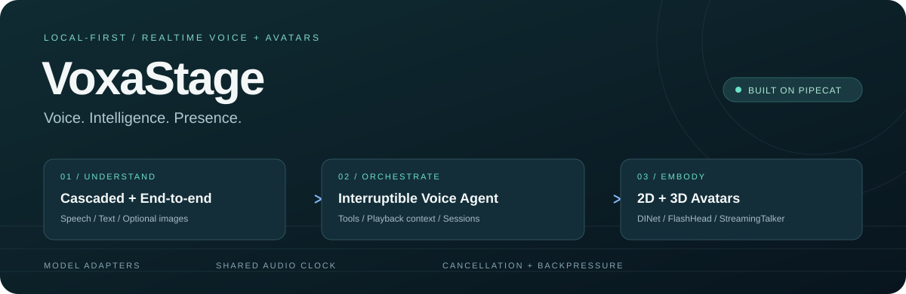
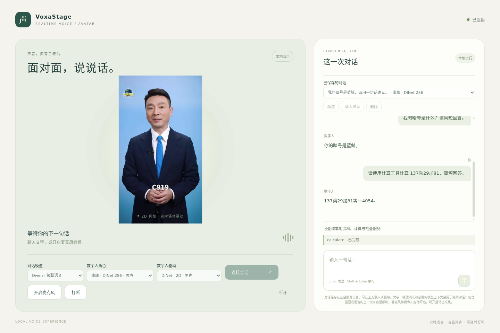
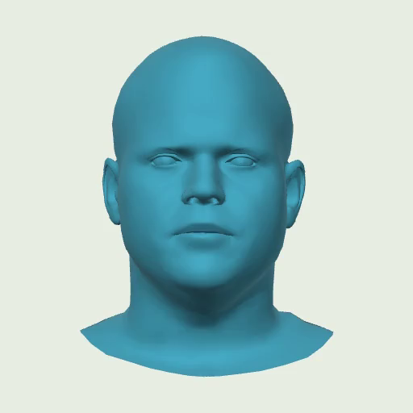
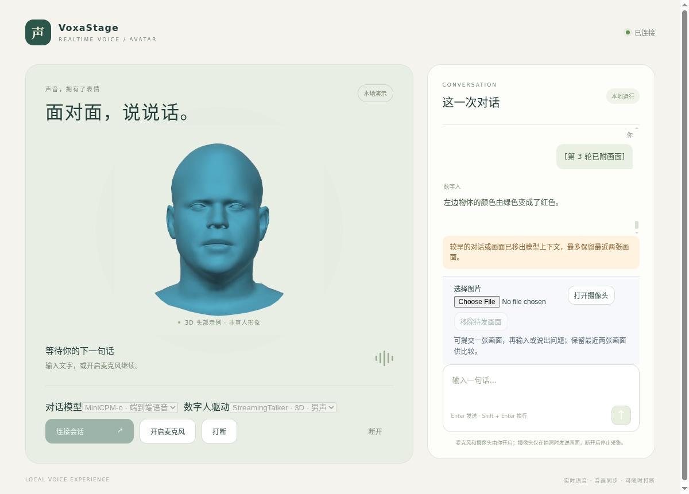
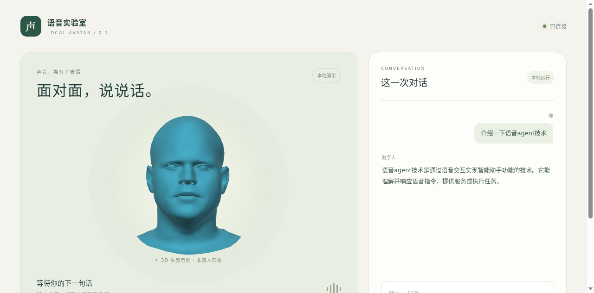
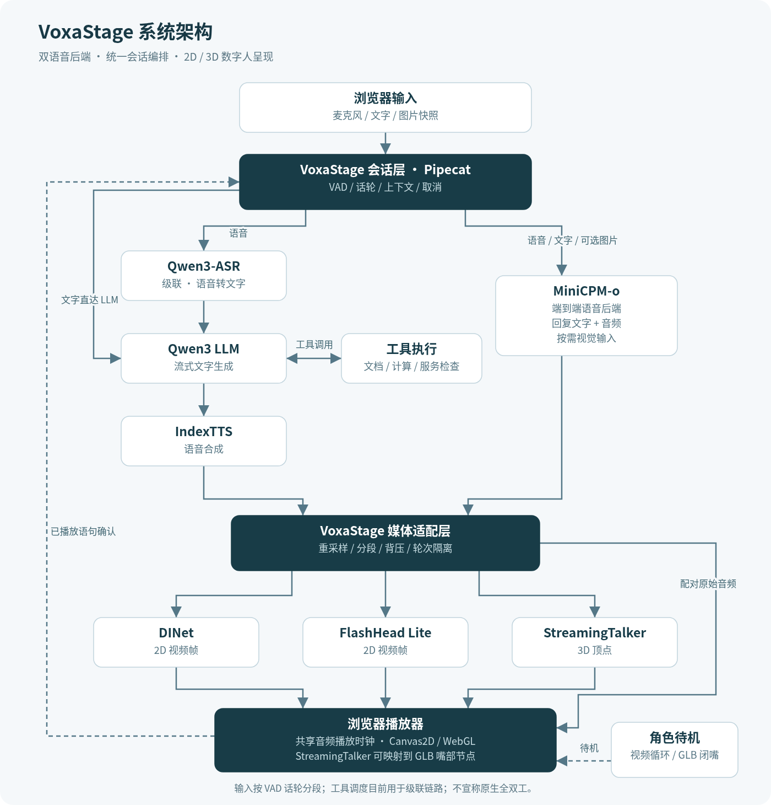

<div align="center">



# VoxaStage

**让对话拥有声音、形象与行动。**

本地优先的实时语音与数字人交互项目 · 基于 Pipecat

**双语音后端 · 三种数字人驱动 · 流式工具调用 · 可打断交互**

[效果预览](#效果预览) · [核心设计](#核心设计) · [系统架构](#系统架构) · [快速开始](#快速开始) · [验证与路线](#验证与路线) · [来源与许可](#来源与许可)

</div>

VoxaStage 将 **ASR → LLM → TTS 级联链路**与 **MiniCPM-o 端到端语音链路**接入统一会话层，让同一套交互可以驱动 **DINet、FlashHead 和 StreamingTalker**。对话模型与数字人形象独立选择，浏览器统一处理音画播放、用户打断和会话恢复。

项目重点是模型之间的协作：**新话轮如何取消旧任务、声音与画面如何对齐、用户打断后模型应该记住什么。** 基础模型由上游提供，VoxaStage 实现服务适配、会话编排、播放生命周期与验证工具。

> **项目状态**：研究与工程演示，面向本地 / 可信网络单用户运行。仓库已设为 **public**；功能与已知限制见[交付状态](docs/STATUS.md)。本页以主分支为准，独立实验分支中的动作编排不计入已交付能力。

## 效果预览



*真实联调截图：同一页面完成角色选择、工具计算与历史会话恢复。音画同步和打断效果需要运行 demo 体验。*

| DINet · 2D 肖像 | FlashHead Lite · 2D 肖像 | StreamingTalker · 3D 网格 |
| :---: | :---: | :---: |
|  |  |  |
| 男声参考 · 音频驱动视频帧 | 女声参考 · 音频驱动视频帧 | 男声参考 · 音频驱动三维顶点 |

DINet 图为康辉角色素材；另两图为部署时的真实 idle 输出截帧。人物、声音和模型资源需另行准备，展示截图不授予素材再使用权。

<details>
<summary><strong>更多界面：按需视觉交互与三维头部</strong></summary>



MiniCPM-o 可结合上传图片或单次摄像头快照回答；当前不包含连续视频理解。



早期联调界面页眉仍为“语音实验室”，现已更名为 VoxaStage。

</details>

## 核心设计

| 设计 | 已实现的行为 | 工程价值 |
| --- | --- | --- |
| **对话与形象解耦** | 两条语音后端独立搭配三种数字人驱动 | 更换语音模型时复用播放与交互层 |
| **流式 Agent** | 级联链路执行文档检索、读取、计算与服务检查；显示任务进度 | 将工具执行纳入可取消的语音话轮 |
| **打断与旧结果隔离** | 新话轮停止旧播放，取消旧任务，清空队列并过滤迟到结果 | 改目标后，旧工具结果或旧音视频不会继续接管当前对话 |
| **播放感知上下文** | 按浏览器确认播放的完整语句段保留历史，未确认部分记录中断 | 让下一轮基于实际播放进度继续，尚不支持逐词确认 |
| **统一媒体时钟** | 音频与对应视频帧 / 网格按浏览器播放时钟调度；有界队列与背压 | 协调模型输出、网络传输与浏览器播放节奏 |
| **会话与角色生命周期** | 本地会话保存 / 恢复 / 删除，角色绑定参考音色和 idle | 从短暂演示走向可持续交互 |
| **按需视觉与 3D 扩展** | MiniCPM-o 接收图片；StreamingTalker 唇距映射到独立 GLB 上下颚 | 为多模态输入和自定义角色提供明确接入点 |

工具编排目前用于级联链路。MiniCPM-o 保留端到端语音和可选视觉路径，尚未接入同一套工具调度。详见[流式功能](docs/STREAMING-FUNCTIONS.md)、[视觉交互](docs/VISUAL-INTERACTION.md)和 [3D 角色接入](docs/MESH-RETARGETING.md)。

## 系统架构



**Pipecat 负责管线编排，级联与端到端描述模型链路。** 两条链路均按 VAD 切分用户话轮；输出采用流式生成或分段播放，当前不宣称原生全双工。

视频角色在等待、打断和通话结束后切回 idle；GLB 角色显示闭嘴模型。主分支的 GLB 接入只实现嘴部开合映射，不包含完整音素、情绪或全身动作生成。

## 快速开始

需要 **Python 3.11、uv，以及可访问的模型服务**。应用安装与模型部署分开进行；模型权重、人物模板、参考音色和 idle 视频不随仓库分发。

```bash
git clone https://github.com/yangohuang/VoxaStage.git
cd VoxaStage
bash install_demo.sh
cp .env.example .env
# 编辑 .env：配置模型服务地址、已注册音色与数字人驱动。
.venv/bin/python demo.py check
.venv/bin/python demo.py run
```

仓库已公开，可以直接克隆源码。

打开 **<http://127.0.0.1:18314/avatar>**，选择对话后端与数字人，点击「连接会话」，输入文字或开启麦克风。纯语音入口为 `/`；两个入口共享单个会话名额。远程部署请使用 localhost 端口转发或 HTTPS，满足浏览器麦克风安全上下文要求。

| 部署内容 | 文档 |
| --- | --- |
| 环境配置、协议与启动检查 | [部署指南](docs/DEPLOYMENT.md) · [.env.example](.env.example) |
| 本地 ASR / LLM | [ASR 服务](asr-server/README.md) · [LLM 服务](llm-server/README.md) |
| TTS 服务对接与音色 | [TTS 兼容层](tts-compat/README.md) · [体验配置](docs/EXPERIENCE-UPGRADE.md) |
| 2D 数字人 | [DINet 接入](docs/DINET-DEPLOYMENT.md) · [FlashHead worker](video-server/README.md) |
| 3D 数字人与自定义角色 | [StreamingTalker worker](avatar-server/README.md) · [GLB 嘴型映射](docs/MESH-RETARGETING.md) |
| 端到端语音与视觉 | [MiniCPM-o worker](omni-server/README.md) |

### 一条演示路线

1. **对话**：用级联后端询问项目架构，观察文字、声音和画面输出。
2. **工具**：输入“请使用计算工具计算 137 乘 29 加 81”，观察任务状态与结果。
3. **打断**：回答期间再次开口或点击「打断」，改成另一项任务，检查旧回复是否停止。
4. **恢复**：保存会话，重新载入后继续之前的话题。
5. **多模态**：在已启用视觉的 MiniCPM-o 后端上传图片并提问，再切换数字人比较表现。

完整步骤与预期行为见[演示路线](docs/DEMO-WALKTHROUGH.md)。

## 验证与路线

项目区分**功能正确性、固定输入实验和主观体验**。下表是带日期的历史证据，不代表服务当前在线，也不把一次演示外推为普遍质量结论。

| 范围 | 已有证据 | 仍需验证 |
| --- | --- | --- |
| 双链路 × 三驱动 | [多驱动验收](AVATAR-MULTIDRIVER-RESULTS.md)、[服务恢复](docs/SERVICE-RECOVERY-VALIDATION.md)记录真实模型播放与打断恢复 | 实际设备的回声、延迟与长期稳定性 |
| 中英混合与 ASR | [固定输入采集](docs/ASR-LIVE-BASELINE.md)、[MiniCPM 术语对照](docs/MINICPM-SPEECH-CONTEXT.md)保留输入、配置与失败 | 真人语音、噪声和更广泛术语覆盖 |
| 复杂回答 | [回答质量基线](docs/REPLY-QUALITY-BASELINE.md)：24 次 MiniCPM 策略对照及 12 次 Qwen 文字参考 | 前提理解与概念准确性；未采用的策略明确保留 |
| 视觉交互 | [真实多模态基线](docs/REAL-MULTIMODAL-BASELINE.md)、[111 次提示消融](docs/VISUAL-GROUNDING-ABLATION.md) | 更广泛图片与场景，不能据此宣称解决幻觉 |
| 媒体与数字人 | [输出基线](docs/AVATAR-OUTPUT-BASELINE-2026-09-19.md)、[3D 结构分析](docs/AVATAR-GEOMETRY-BASELINE.md)、[DINet 节奏实验](docs/DINET-PACING-INTEGRATION.md) | 人工口型、画面连续性与音色匹配 |
| 自定义 3D 角色 | [GLB 接入](docs/MESH-RETARGETING.md)验证录制推理回放、闭嘴与旧帧过滤 | 在线完整对话、独立嘴型层与全身动画组合 |

自动化检查入口：

```bash
.venv/bin/python -m unittest discover -s . -p 'test_*.py'
.venv/bin/python -m unittest discover -s omni-server -p 'test_*.py'
.venv/bin/python -m unittest discover -s evaluation -p 'test_*.py'
node --test avatar-web/tests/*.test.mjs
# 需要已部署的真实模型服务：
.venv/bin/python smoke_avatar.py --interrupt
```

Node 18+ 用于前端测试。评测工具见[适配层评测](docs/AVATAR-EVALUATION.md)与[本地质量复核](docs/AVATAR-QUALITY-REVIEW.md)。

**下一阶段**：优先完善中英混合识别与回答质量评测、3D 角色动作与嘴型分层，以及空白 GPU 主机的完整部署复现。逐词播放确认需要真实对齐信息；连续视频理解、多用户与公网服务另行推进。详见[阶段验收](docs/ACCEPTANCE.md)。

当前限制：单会话最长 10 分钟；云端兼容接口已有协议适配但未完成真实 API 联调；有界队列不能消除推理欠载或浏览器后台节流。当前版本不提供公网认证与多租户隔离。

## 来源与许可

| 上游项目 | 提供的基础能力 | VoxaStage 的工作 |
| --- | --- | --- |
| [Pipecat](https://github.com/pipecat-ai/pipecat) | 处理器管线、VAD、话轮与上下文机制 | 本地服务适配、后端组合、话轮策略与会话生命周期 |
| [Qwen3-ASR](https://github.com/QwenLM/Qwen3-ASR) / [Qwen3](https://github.com/QwenLM/Qwen3) | 语音识别与文本生成 | 流式服务、术语配置、工具集成与对照评测 |
| [IndexTTS](https://github.com/index-tts/index-tts) | 语音合成与参考音色 | 既有服务对接、角色音色映射与兼容修复 |
| [MiniCPM-o](https://github.com/OpenBMB/MiniCPM-o) | 端到端语音与视觉理解 | 独立 worker、视觉输入契约、取消与播放确认；延续作者 MindTalker 的接入经验 |
| [DINet](https://github.com/MRzzm/DINet) | 音频驱动人脸视频 | 特定既有部署的 WebSocket 客户端与节奏控制；不是官方标准 API |
| [SoulX-FlashHead](https://github.com/Soul-AILab/SoulX-FlashHead) | Lite 肖像视频生成 | 流式桥接、音视频配对与单 GPU 兼容补丁 |
| [StreamingTalker](https://github.com/zju3dv/StreamingTalker) | 音频驱动三维人脸 | 固定版本增量服务、取消协议、浏览器网格播放与角色嘴型映射 |
| [Three.js](https://github.com/mrdoob/three.js) | 浏览器三维渲染与 GLTF 加载 | 独立 GLB 角色加载、嘴部节点映射与播放集成 |

VoxaStage 不包含上述基础模型的预训练或原创网络设计。固定版本、分发范围、补丁归属与许可原文见 [THIRD_PARTY.md](THIRD_PARTY.md)。

集成层与前端采用 [MIT License](LICENSE)。第三方代码、模型权重、FLAME / VOCASET 数据及人物、声音素材分别遵循原始条款。StreamingTalker 随包历史基线与当前上游许可存在差异，以 [NOTICE](avatar-server/NOTICE.md) 为准；不能将全部权重与素材视为 MIT 或 Apache-2.0。

<details>
<summary><strong>源码导出与隐私边界</strong></summary>

```bash
python3 export_demo.py
```

生成 `dist/voxastage-source.tar.gz` 与 SHA256 文件清单。导出包含源码、文档和明确列出的展示图片；排除运行配置、凭据、模型权重、日志、会话录音及运行时音视频。导出前仍应复核新增内容和素材授权。

</details>
