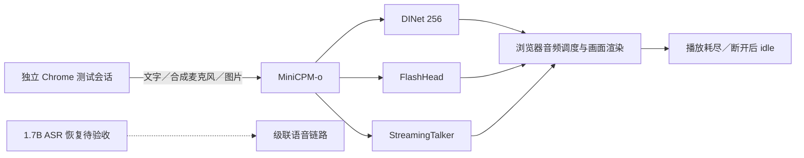

# 服务恢复与浏览器联调记录

2026-10-10。前一轮已恢复独立 LLM、MiniCPM 和 StreamingTalker，本轮恢复应用、TTS 与 FlashHead，并通过真实模型的网页交互检查。应用源码为 `bbcffedd87827f532543c236d16eaed5fc7c4eb6`，本轮没有修改模型或应用算法。

**当前只证明 MiniCPM 链路已恢复联动。** 默认级联链路依赖的 Qwen3-ASR-1.7B 原临时目录已不存在；固定版本模型和独立环境正在重新准备，尚未完成加载、推理与级联浏览器验收。没有把默认模型静默降为 0.6B，也没有把后端单独 ready 作为整站 ready。

## 实际修复

- **TTS**：原容器的配置文件属主与运行用户不一致，启动脚本无法重写配置，形成重启循环。恢复配置属主，并让入口脚本显式保留原音色映射；男声和女声均完成真实合成。这是现有容器层修复，尚未作为干净镜像安装复现，容器重建不能直接沿用该结论。
- **FlashHead**：从既有独立环境、上游源码和模型恢复持久服务。3次完整请求、1次客户端主动断连及1次恢复请求通过，共4次完整输出、1次部分输出；没有对动态嘴型进行主观评分。
- **应用**：以当前主分支源码启动。初次启动因会话存储路径包含符号链接被安全检查拒绝；把运行配置改为原存储目录的规范绝对路径后启动成功，未关闭防符号链接检查。原会话数据保留。

上述恢复不是空白主机全量安装，也未验证整机重启后的恢复。完整 ASR 恢复仍是后续门槛。

## 浏览器检查

使用独立无头 Chrome，连接按钮通过实际浏览器点击解锁 AudioContext；没有绕过自动播放策略。观测探针仅记录 WebSocket 事件及音频调度，不替产品发送播放确认。

| 检查 | 范围 | 实际结果 |
| --- | --- | --- |
| 文字回复 | MiniCPM × 三种驱动，各1轮 | 文字回复、音频调度与画面渲染均出现；分别渲染57、53、74帧；播放耗尽及断开后 idle |
| 语音输入及手动打断 | 合成语音作为虚拟麦克风，三种驱动各1组 | 收到非静音输入包；播放中手动打断，已排程音频清空，服务重置后250ms内旧帧数不再增长；随后文字回复完成并回到 idle |
| 图片与上下文 | MiniCPM＋DINet，同会话两张合成图 | 第一轮回答“左边的物体是红色的圆形。”；换图后回答“左边物体的颜色由红色变成了绿色。”；两轮均完成播放 |

语音检查每组含一条被手动打断的语音输入回复和一条完整的文字恢复回复。与3条文字检查、2条看图回复合计11条模型回复：8条完整播放，3条中途打断。合成输入不是实体麦克风录音；手动打断不是声学语音抢话测试。

两张图均通过产品文件控件提交、前端缩放和JPEG编码。服务返回 `visual_bound`，分别绑定第1、2轮，保留 `captured_at_ms`、`received_at_ms` 和实际提交图片摘要。对上传图片，`captured_at_ms` 是会话内选择文件时的相对时间，不是原图片拍摄时间；客户端与服务器时钟不能直接相减作为网络延迟。第二轮回答与图中已知变化相符，只能支持这一对受控输入的上下文行为，不能代表通用视觉理解准确率。

三个正式浏览器测试组均未观察到 JavaScript 未捕获异常。最初一次文字测试误选了 Chrome 扩展后台页，未加载产品页面；已保留该次中止记录，选择 `type=page` 后重新执行正式检查。没有将无页面的尝试列为产品通过。

## 证据与复查

- [三驱动文字与 idle](benchmarks/2026-10-10-service-recovery-text.json)
- [合成麦克风、手动打断与恢复](benchmarks/2026-10-10-service-recovery-voice.json)
- [两张图片的绑定和实际回答](benchmarks/2026-10-10-service-recovery-visual.json)

公开JSON从本地原始结果中选取字段，附原文件与测试脚本摘要；删除会话标识、本机路径及完整事件轨迹。脚本摘要用于关联记录，不能替代可执行脚本。观测探针和语音轮次检查逻辑分别见 [browser-probe.js](../evaluation/browser-probe.js)、[browser-round.js](../evaluation/browser-round.js)；此次浏览器启动和驱动脚本依赖本机路径，未发布为通用验收命令。

复查时先按[部署说明](DEPLOYMENT.md)启动所需后端，选择 MiniCPM 和目标角色，依次执行简短文字回复、语音输入后手动打断再发文字、两张图片的连续提问，观察播放结束与断开后的 idle。语音合成及人物驱动来自各自上游，本项目贡献是服务编排、会话与媒体协议、故障定位及可追溯验证。

单轮首播放观测保留在JSON中，没有重复统计或同条件旧版本对照，不作为性能提升结论。人工中英混合听写、广泛语义与动态口型质量、实体麦克风/扬声器回声和端到端声学延迟，以及独立GPU主机全量安装仍未验收。
