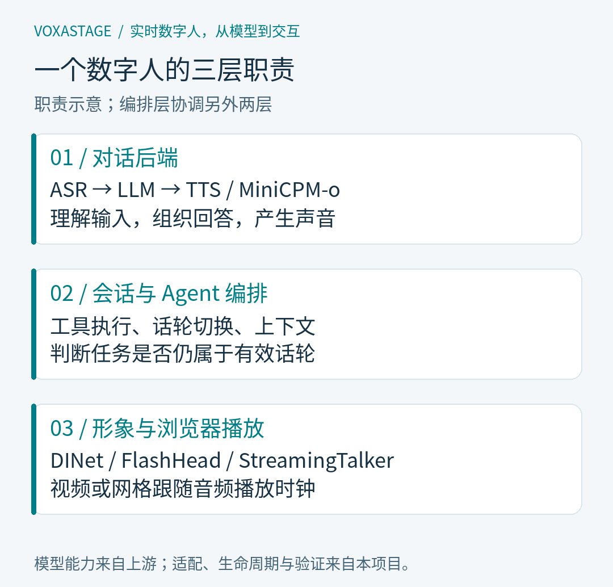
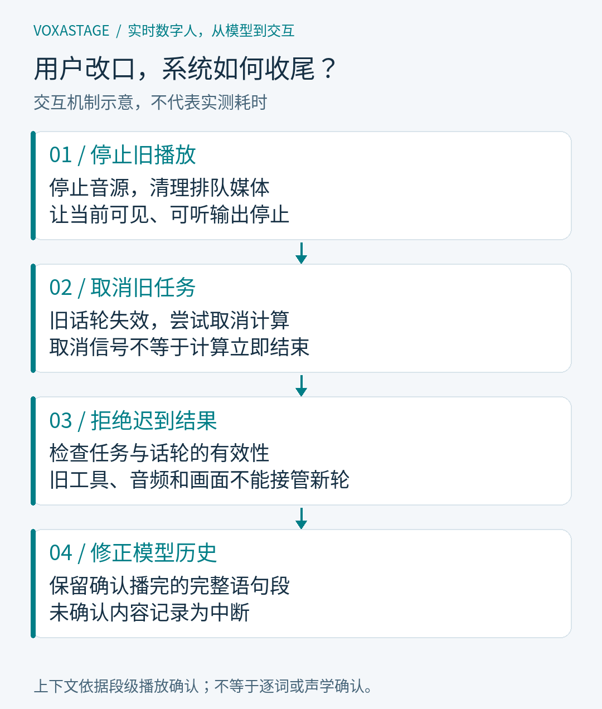

# 做一个能听、能说、能行动的数字人，需要哪些模块？

- 摘要：把语音识别、大模型、语音合成和数字人模型连起来，只是起点。真正困难的是让工具、声音和画面遵守同一个话轮：用户改口后停止旧任务，播放结束后正确记忆，切换形象时复用对话能力。本文用 VoxaStage 的实际结构，拆解这套实时系统的职责与边界。
- 封面主文案：让数字人真正进入对话
- 封面副文案：语音 · Agent · 形象，三层怎么协作
- 阅读前置知识：知道大模型能生成文本即可；不要求了解数字人训练。
- 对应代码版本：`dd44878`。本文描述该版本源码与已记录验证，不保证某台演示机器此刻运行同一配置。
- 系列：实时数字人，从模型到交互 · 01

<!-- article:begin -->

假设你让数字人检索项目文档，介绍它支持哪些驱动。它刚讲到一半，你说：“停一下，只介绍三维的。”声音停住了，可过了一会儿，上一轮的检索结果才回来。

这份结果该怎么办？直接交给模型，旧话题就可能重新冒出来。把声音关掉也不够，已经排进浏览器的画面仍有机会闪回来。甚至什么都没有继续播放，下一轮对话也可能出错：模型记着一段用户根本没听完的解释。

VoxaStage 处理的就是这类问题。项目接了两条语音后端和三种数字人驱动，用 Pipecat 组织会话。模型分别负责识别、回答、合成声音和生成人脸，应用负责让它们在同一轮对话里协作。前面这个小场景可以作为阅读代码的线索：用户改口后，沿着工具、声音和画面往下追，看看旧数据在哪里被挡住。

## 两个选择框背后的分工

页面上，对话后端和数字人驱动是分开选的。对话可以走 ASR → LLM → TTS，也可以交给 MiniCPM-o；形象则可以用 DINet、FlashHead 或 StreamingTalker。这种搭配让声音的来源和画面的生成方式不必绑在一起。

DINet 和 FlashHead 在当前集成中返回二维视频，浏览器拿到的是图像序列。StreamingTalker 返回三维人脸网格，浏览器更新顶点后再渲染。它们给播放器的东西不同，但都要回答同一个问题：这一帧应该和哪一段声音一起出现？

声音也有自己的配置。参考音色决定合成的声音，渲染器决定人物外观。换一个形象时，可以保留原来的对话后端和声音；换一种声音，也不需要重新实现整套渲染器。项目里的男女声只是音色映射，不是展示人物本人的声纹。

把这些选择拆开，代价是要多做一层适配。采样率、分块方式、时间戳、取消行为，不能指望上游模型恰好一致。对话后端负责产出声音，会话层管理它属于哪一轮，媒体层再把声音和画面送到浏览器。协议没有处理清楚，换模型时省下的工作会在播放阶段重新找回来。

*图 1：这里按职责分层。会话编排协调对话与播放，并不是模型之间多出来的一种推理方式。*

Pipecat 也应放在这个位置理解。它提供处理器管线和会话基础设施，MiniCPM-o 提供模型推理。二者能用在同一套应用里。级联、端到端讨论的是语音模型怎么连接，和选哪个编排框架是两件事。

## 输入换了一条路，调试也要跟着变

级联路径的一个实用之处，是中间结果容易留下来。技术术语被识别错了，先看转写；转写没错但回答跑题，就检查真正送给大模型的消息；文字正常而发音不对，再查语音合成。排障不一定因此变简单，但至少有几个明确的检查位置。

MiniCPM-o 路径直接接收语音并生成语音，也能结合按需提交的图片。它不需要先经过独立的 ASR 和 TTS 适配器。于是，级联里某些方便的观察点消失了：想判断回答为何出错，得回到输入音频、历史上下文和模型输出，不能总是沿用“先看转写”的办法。

从调试角度看，两条路径值得同时保留，因为它们提供的观察条件和接入能力不同。具体场景该用哪个，要拿相同输入去试，而不是从“端到端”三个字推断识别更准、回答更好或者延迟更低。

当前应用仍然按话轮处理输入。级联的 ASR 由 VAD 分段，文本和音频可以增量输出；MiniCPM-o 也由应用管理话轮边界。边生成边播放、回答时能被打断，都不能单独证明模型已经在持续同时听和说。这个版本没有宣称原生全双工。

如果只测模型第一个输出到达的时间，还会漏掉用户切实等着的部分：话轮结束的等待、音频的准备、数字人的供帧，以及浏览器真正开始播放。后续比较两条路径时，需要把这些时间点分别记下来。

## 让工具回答之前，先确认它还属于当前问题

级联路径目前有四类真实工具：文档检索、文档读取、算术计算和服务状态检查。模型通过受限文本协议提出调用，执行器检查请求、运行对应函数，再把结果交回模型。页面上的执行中、完成、失败或取消，对应的是这段实际过程。

“我正在查询”这句话本身没有执行任何查询。检查 Agent 是否用了工具，要能找到调用参数、执行状态和返回值。对当前项目来说，这比让模型把回答写得像查过资料更重要。

不过，工具跑得慢一点，对话就可能已经换了方向。回到开头的例子：用户改成只听三维驱动后，上一轮的检索结果即使完全正确，也不能不加判断地进入当前回答。执行器需要确认任务仍然有效，过期结果应当被丢弃。

取消和丢弃各有用途。取消尽量减少无用计算；有效性检查防止没有及时停下来的旧任务影响新对话。底层操作是否立即响应取消，并不是应用可以一概保证的，所以两道处理都要保留。

这套工具调度只接在级联路径上。MiniCPM-o 保留端到端语音与可选视觉输入，尚未接入同一套执行器。选项出现在同一个页面，不代表功能已经完全对齐。

## 最后一句话，要以播放为准

声音生成出来后，还没到用户耳边。

浏览器可能已经收到了几段音频，正在播第一段，后面几段仍然排队。数字人的帧也在陆续到达。VoxaStage 用浏览器的音频播放时钟调度对应画面，用有界队列限制积压，并过滤不再属于当前话轮的数据。

这套处理需要同时看时间和归属。帧属于哪一轮，决定它现在还能不能出现；音频播到哪里，决定它应该什么时候出现。只按网络到达顺序显示，后到的旧帧就可能占用新一轮的画面。只检查话轮而不管播放进度，声音和动作又可能错开。

用户打断时，前端停止旧音源、清理音画队列；服务端让旧话轮失效并取消相关任务。后续返回的工具结果、音频和画面，仍要经过归属检查。发送了取消指令，不等于所有底层计算已经在同一瞬间停止。

*图 2：一次打断涉及多处状态。清理播放队列之后，旧结果和对话历史还需要各自处理。*

历史记录是这里很容易漏掉的一处。假设模型生成了五段解释，浏览器只播完两段，第三段刚开头就被打断。如果把五段全文放进模型历史，下一轮它可能省略关键步骤，因为它以为自己已经解释过了。

当前实现按浏览器确认播完的完整语句段保留历史，未确认部分记为中断。显示层可以保留完整生成记录，让用户回看；模型使用的上下文则更保守。没有可靠的逐词对齐信息，就不根据播放时长猜用户听到了哪个字。浏览器确认同样只是软件事件，不证明人确实听见了。

有界队列也有它做不到的事。模型如果持续慢于播放，队列不会凭空补出音频或画面；浏览器后台节流也会改变调度。播放器能把已经到达的数据安排好，推理吞吐和最终口型观感仍要另测。

## 现在可以复现到哪一步

VoxaStage 的基础模型来自上游：语音识别和文本生成、IndexTTS、MiniCPM-o，以及三个数字人模型。Pipecat 提供编排基础，Three.js 负责浏览器三维渲染。项目新增的是服务适配、后端组合、工具执行、播放与会话管理，以及检查这些行为的实验工具。

这个区别也决定了怎么看成绩。现有适配基线记录了三驱动共 54 次请求，另一组记录保存了 45 次输出捕获。它们支持协议和输出检查，但人工口型、音色评价还没有因此完成。合成输入与浏览器调度记录，也不能替代物理麦克风到扬声器的延迟测量。

要复现，先按部署文档准备应用与模型服务。权重、人物模板和参考音色需要另行提供，运行录音不随源码分发。第一次进入页面，可以先发一个计算请求，再在回答中途打断、换问题，最后切换驱动检查恢复。这几步分别能看到工具、话轮和媒体层是否接通。

更广泛的真人中英混合语音、动态音画评价、回声，以及独立空白 GPU 环境的完整部署，还留在验收清单里。连续视频理解、完整卡通动作和决策模型也是后续工作。阅读代码时，以本文引用的版本为准；下一篇会沿着同一段输入，比较级联和 MiniCPM-o 各自留下了哪些可供排障的线索。

<!-- article:end -->

## 复现与参考

- [VoxaStage 源码与来源说明](https://github.com/yangohuang/VoxaStage/tree/dd44878)
- [部署指南](https://github.com/yangohuang/VoxaStage/blob/dd44878/docs/DEPLOYMENT.md)与[演示路线](https://github.com/yangohuang/VoxaStage/blob/dd44878/docs/DEMO-WALKTHROUGH.md)
- [流式工具与播放确认](https://github.com/yangohuang/VoxaStage/blob/dd44878/docs/STREAMING-FUNCTIONS.md)
- [阶段验收与证据边界](https://github.com/yangohuang/VoxaStage/blob/dd44878/docs/ACCEPTANCE.md)
- [三驱动基线](https://github.com/yangohuang/VoxaStage/blob/dd44878/docs/AVATAR-BASELINE-2026-09-19.md)与[输出捕获](https://github.com/yangohuang/VoxaStage/blob/dd44878/docs/AVATAR-OUTPUT-BASELINE-2026-09-19.md)
- [第三方来源与许可](https://github.com/yangohuang/VoxaStage/blob/dd44878/THIRD_PARTY.md)

[系列目录](../README.md) · [下一篇：级联还是端到端？](02-cascade-and-omni.md)
