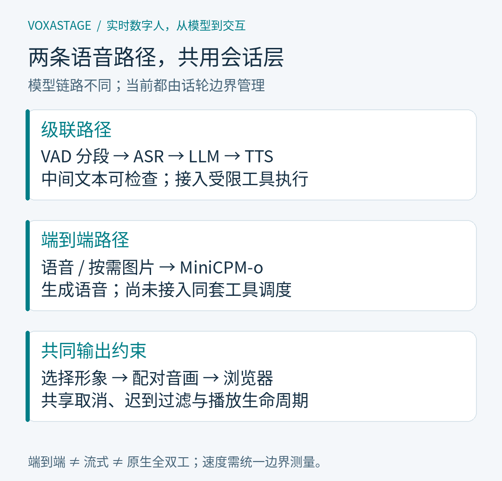
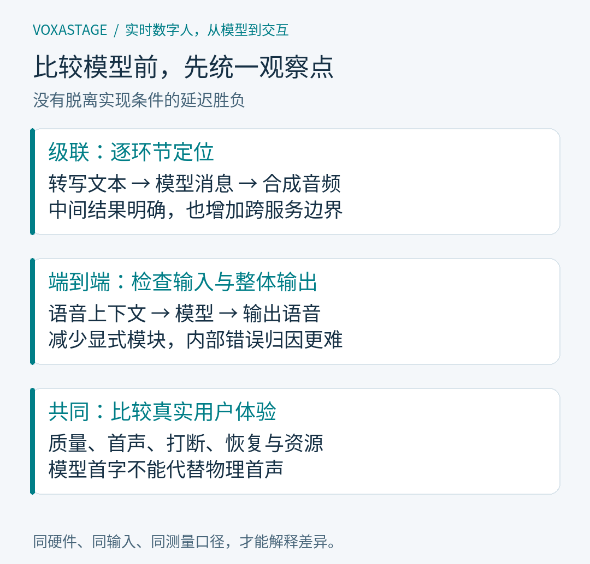

# 级联还是端到端？把两条语音链路放进同一个系统之后

摘要：级联语音与端到端语音的差别，落到应用里会变成接口、调试、话轮和上下文问题。本文沿着 VoxaStage 的两条实际链路，解释哪些能力能够共用，哪些必须保留差异，以及为什么流式输出不能直接等同于原生全双工。

封面主文案：两条语音链路，一套系统

封面副文案：级联与端到端：接口、调试与边界

阅读前置知识：了解语音识别、语言模型与语音合成的基本职责；不要求阅读过框架源码。

基准版本：`dd44878`

<!-- article:begin -->

## 一、选模型之前，先确定系统要接住什么

假设一个语音助手既要回答问题，又要检索项目文档，还要驱动屏幕上的数字人。用户可能在回答中途改口，也可能关闭页面之后回来继续。此时，“语音效果怎么样”只是一个入口问题。工程实现还要回答：当前回复属于哪次提问，工具结果何时可以进入上下文，音频播放到哪里，以及换一种模型后哪些会话规则仍然成立。

VoxaStage 把两条语音链路放在同一应用中。级联链路采用语音识别、文本模型和语音合成三个阶段；另一条接入 MiniCPM-o，让模型直接接收语音并生成语音。两者共享浏览器入口和数字人会话层，但内部处理路径分别实现。讨论它们的意义，在于把架构选择落实到可检查的接口和责任上。

这里的基础模型来自上游项目：Qwen3-ASR 提供识别能力，Qwen3 提供文本生成，IndexTTS 提供语音合成，MiniCPM-o 提供端到端语音及可选视觉能力。Pipecat 提供处理器管线等基础设施。VoxaStage 的工作集中在服务适配、会话编排、取消、历史与媒体播放，没有重新训练这些基础模型。

## 二、级联链路把中间结果摆在明处

级联的输入先经过语音活动检测，再把分段音频交给识别服务。识别文本进入会话上下文，文本模型增量生成回答，语音合成服务把适合朗读的文字转换成音频。数字人会话接收音频片段，交给选定的驱动生成画面或网格，最后由浏览器播放。识别、生成和合成分别有服务适配器，因此每个阶段都有可以核查的输入输出。

这些中间结果直接影响排障方式。若用户说的是一个技术术语，屏幕转写已经变成另一个词，就应先检查识别输入和术语配置；若转写正确、回答却混淆模块职责，则需要检查上下文、检索结果和文本生成；若文字正确、发音不合适，就应查看合成环节。这样的判断仍需证据，但至少能够明确下一步该采集什么。

文本边界也为工具接入提供了位置。当前级联运行时能够解析受限的工具调用文本，执行文档检索、文档读取、算术计算和服务状态查询，再把结果交回模型继续回答。用于调度的标记不进入朗读内容。这套能力属于应用运行时，不能因为另一条链路也会输出文字，就推定它已经具备同样的工具执行能力。

级联同时带来更多需要协调的边界。识别什么时候结束、文字何时组成一个合成片段、旧合成请求如何取消，都可能影响体验。一个阶段已经结束，并不代表整轮播放结束。服务拆得清楚有助于观察问题，也意味着应用必须承担更多阶段之间的状态转换。

## 三、端到端减少的是模型链路中的转换

MiniCPM-o 路径绕过独立识别与合成适配器：应用收集用户的一段语音，带上受限的历史上下文，发给独立模型服务；客户端读取流中的文字与音频事件，再把音频交给已有的数字人会话。选择这种后端后，应用不需要先获得一份独立识别服务的转写，才能开始请求模型。

这个区别也体现在页面表达上。当前语音输入的记录可以显示为“语音输入”，它不是模型已经识别正确的转写证据。模型能够理解原始音频，与应用能展示可靠的逐字识别结果，是两个不同的接口承诺。诊断回答错误时，需要保留实际输入音频、上下文和生成事件，不能把一个占位标签拿来证明识别没有问题。

端到端也没有消除协议。客户端先校验元信息，再处理文字与音频，检查音频格式、累计采样数、事件顺序和结束标记。流意外截断、音频总量不符，仍然需要明确报错。这里的价值是把模型输出转换成应用可消费的事件，而不是让浏览器直接接受任何模型服务返回的数据。

视觉输入是这条路径的另一项能力：开启后可以附带图片或单次摄像头快照。它有独立的图片绑定与历史限制，不表示连续视频理解已经完成。当前 MiniCPM-o 路径也没有接入级联的工具调度；把两种后端放进同一个选择框，不会自动补齐它们的能力差异。

*图 1：级联经过独立识别、文本生成和语音合成；MiniCPM-o 接收分段语音并输出文字与音频。两者复用会话与媒体呈现，工具调度目前只属于级联路径。*

## 四、统一接口要统一责任，保留能力差异

在应用入口，对话后端和数字人驱动分别选择。对话后端决定如何理解输入、生成回答；数字人驱动决定如何将回答音频转换为视觉输出。因此，DINet、FlashHead 和 StreamingTalker 不需要分别绑定某一种对话模型。对话链路产出符合约定的音频后，就能进入相同的媒体生命周期。

共同会话层负责分配轮次、管理音频片段、限制积压、发送媒体以及接收播放确认。它关心音频是否属于当前轮次、片段是否结束，而不负责推断模型如何理解了问题。这样的职责划分，使“换一个对话后端”和“换一个形象驱动”成为两个相对独立的操作。

统一也有不能越过的地方。级联历史主要保存文本；端到端历史可能携带音频与图片，需要不同的字段和预算。恢复会话时，系统绑定原来的对话后端和角色，避免把一种后端的记录直接解释成另一种后端的上下文。接口相同不等于历史格式、功能范围和运行资源都相同。

如果继续接入新后端，首先应约定它能接收什么、怎样报告结束、取消后如何处理迟到结果，以及能提供何种文本与音频对应关系。仅仅实现一个“返回音频”的函数，还不足以接入完整对话。播放、打断和恢复都会检验这些约定是否明确。

例如，一个后端能够返回文字和声音，却没有稳定的对应边界，就不能承诺精确记录用户听到了哪一段。应用需要选择保守的确认粒度，并在接口中说明限制。又如，模型服务仍在清理上一轮时，新请求可能暂时无法接收，客户端需要识别这种状态，而不是把它解释成用户没有说话。这些处理并不改变模型能力，却决定能力能否可靠地进入会话。

## 五、能够边生成边播放，仍然有话轮边界

“流式”容易被用来描述几种不同的事：文字增量到达，音频分块返回，浏览器尚未收到整轮内容就开始播放。VoxaStage 的输出采用流式生成或分段播放，但输入仍有明确的话轮切分。级联依赖 VAD 分段识别，MiniCPM-o 也先通过 VAD 收集一段语音，再提交模型。

在端到端处理器里，检测到用户开始说话会触发打断；检测到安静，或者输入缓冲达到限制，才会开始这一段输入的生成请求。由此可见，“能在回答时开口使它停下”描述的是打断机制，“模型持续同时听与说”描述的是另一种交互能力。当前实现不能因此宣称原生全双工。

级联还有转写完成与话轮结束的配合。长语音可能被拆成多个识别片段，代码会等待相关片段处理完，再提交最终转写，避免尾部识别尚未完成就启动回答。VAD 静音阈值和话轮等待参数影响的是这里的边界，不能只凭某个阈值就推算整条链路的响应延迟。

更短的等待可能更敏感，也可能把自然停顿切成多个输入；更长的等待有利于收齐一句话，也会让用户感觉系统迟迟没有接话。这是需要结合真实说话方式、麦克风与回声环境验证的取舍。源码中的默认参数可以说明策略，无法替代现场体验的验收。

## 六、比较两条链路，先设计可定位的实验

同一个页面、同一套数字人驱动和播放方式，提供了比较的共同条件，但不会自动形成公平评测。两条路径的输入上下文、声音设置、输出长度、模型部署都可能不同。若只比较“从点击到出声”的一个数字，很难知道差异来自模型、话轮等待、合成，还是媒体预缓冲。

更有价值的做法是分别记录输入结束、转写完成、首段文字、首段音频、媒体发送和浏览器播放这些边界，并注明某条链路不存在的阶段。文字回答正确性、声音质量和数字人表现也应分别检查。缺少独立转写的端到端链路，需要使用与其接口匹配的证据，不能套用级联的每一个诊断指标。

*图 2：三组卡片分别列出级联观察点、端到端观察点和共同测量边界。它们用于定位问题，不是模型质量排名；不同链路需要与自身接口相匹配的证据。*

本文依据固定版本源码说明机制，没有新增模型实测，也没有据此给出延迟或质量排名。项目中的历史实验应连同输入、配置和失败记录阅读。某个固定样本能够完成，只能支持该样本对应的结论，不能扩展成所有口音、噪声和复杂问题都已经解决。

## 七、架构选择最终落在产品需要承担的责任上

如果应用需要清晰的转写、显式的工具步骤，以及逐阶段检查问题的能力，当前级联实现提供了直接的接入位置。如果希望探索直接语音输入、语音生成与按需视觉交互，当前端到端实现提供了另一条路径。这些判断来自已实现接口，具体质量与资源成本仍需针对目标场景验证。

把两条链路放进同一个系统后，最值得复用的是会话规则：新输入如何取代旧输出，播放进度如何反馈给历史，错误之后如何回到可继续的状态。模型链路可以不同，这些问题却总会出现。下一篇将从用户的一句“停一下”展开，追踪工具、生成、媒体和历史分别需要做什么。

<!-- article:end -->

参考来源（均固定至 `dd44878`）：

- [项目职责、双链路与上游归属](https://github.com/yangohuang/VoxaStage/blob/dd44878/README.md)
- [两条管线的应用装配](https://github.com/yangohuang/VoxaStage/blob/dd44878/avatar_demo.py)
- [级联识别、生成与合成适配](https://github.com/yangohuang/VoxaStage/blob/dd44878/services.py)
- [端到端话轮处理](https://github.com/yangohuang/VoxaStage/blob/dd44878/omni_processor.py)与[流协议检查](https://github.com/yangohuang/VoxaStage/blob/dd44878/omni_backend.py)
- [媒体会话生命周期](https://github.com/yangohuang/VoxaStage/blob/dd44878/avatar_session.py)与[话轮参数](https://github.com/yangohuang/VoxaStage/blob/dd44878/turn_settings.py)
- [流式功能与能力边界](https://github.com/yangohuang/VoxaStage/blob/dd44878/docs/STREAMING-FUNCTIONS.md)

系列导航：[系列目录](../README.md) · [上一篇：项目与系统边界](01-system-map.md) · [下一篇：用户说“停一下”之后，语音 Agent 还要处理什么？](03-interruption-and-tools.md)
