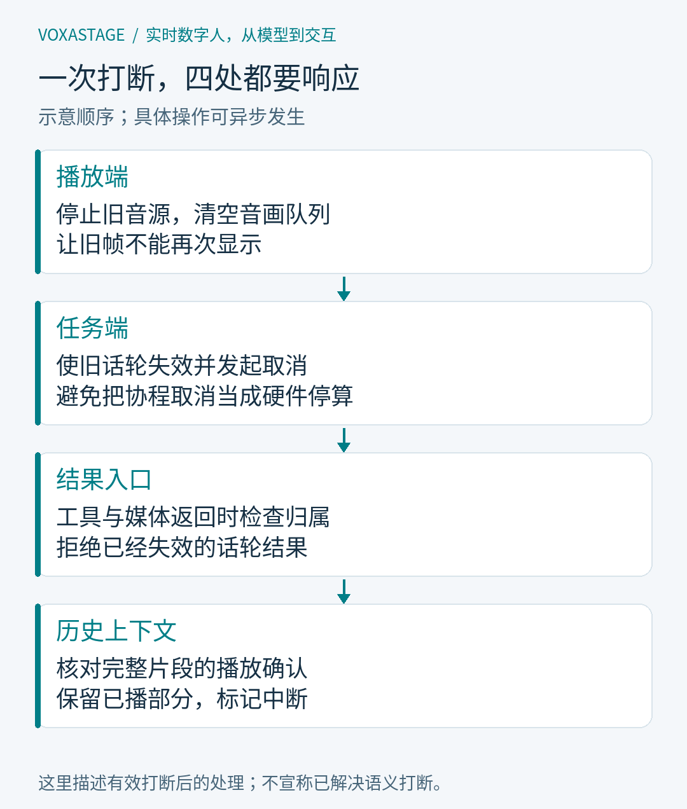
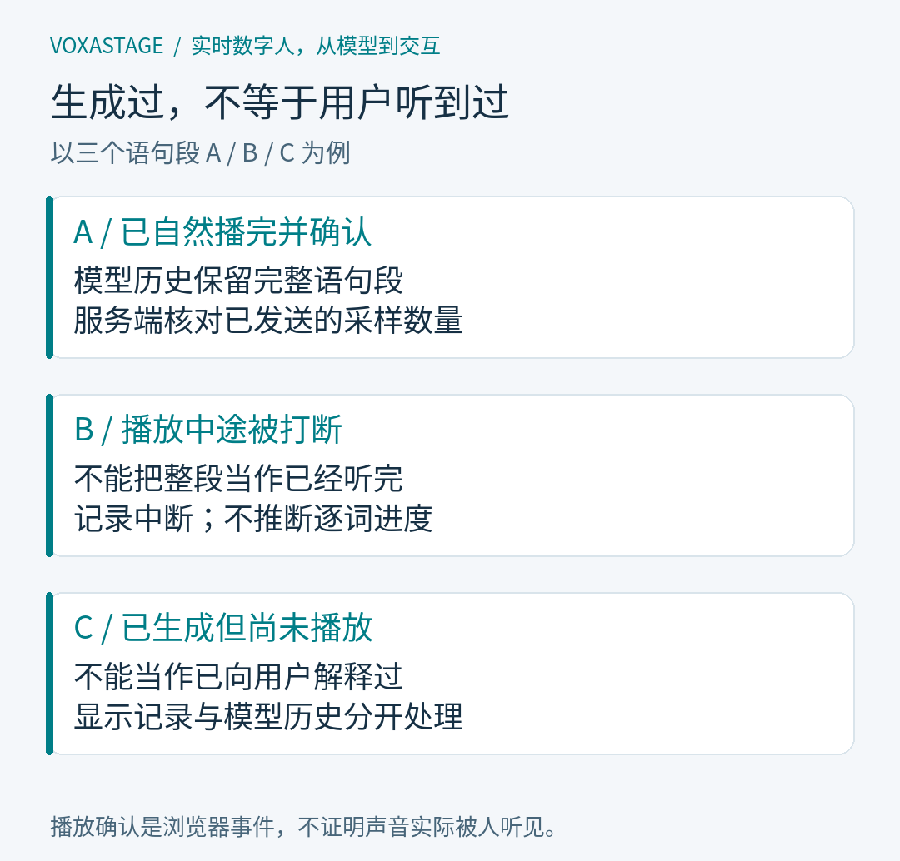

# 用户说“停一下”之后，语音 Agent 还要处理什么？

摘要：一句“停一下”会同时触及工具执行、模型生成、音频播放和会话历史。本文沿着 VoxaStage 的真实实现，解释取消为何需要配合迟到结果隔离，播放确认如何影响下一轮，以及当前机制距离理解用户意图的语义打断还有哪些边界。

封面主文案：“停一下”之后，发生什么？

封面副文案：任务取消 · 旧结果隔离 · 播放确认

阅读前置知识：了解异步任务和语音链路的基本概念；建议先阅读本系列第 02 篇。

基准版本：`dd44878`

<!-- article:begin -->

## 一、声音停了，旧任务可能还活着

设想用户让语音助手检索项目文档。页面已经显示任务执行中，用户忽然改口：“停一下，先帮我算个数。”这只是一个说明时序的情境，不是一次新的实测记录。此时浏览器可以很快停掉声音，但后台检索、模型生成、等待合成的文字和正在传输的媒体，可能分别处在不同阶段。

如果只停止播放器，旧模型仍可能接着生成；如果只取消模型，已经进入播放队列的音频仍可能继续响；如果声音都停了，却把整段生成文字保留在历史里，下一轮模型又会误以为用户听完了前面的解释。用户的一次打断，实际改变了多个组件对“当前任务”的判断。

VoxaStage 把这件事拆成几个互相配合的机制：让旧任务失效，向可取消的工作发出取消，阻止旧结果进入当前轮次，停止并清理播放，最后以已确认播放的内容更新历史。各个环节有自己的状态，不能拿其中某个完成事件代替整轮结束。

本文讨论的是固定版本中的机制边界。项目使用 Pipecat 的管线与中断基础设施，应用层补充工具运行时、轮次隔离、媒体会话和播放历史。基础模型负责识别、生成或合成，取消后的状态一致性则需要应用和播放器一起维护。

## 二、工具是真的执行，范围也是真的受限

当前级联链路有四类工具：检索项目文档、读取白名单文档、计算算术表达式，以及查询配置中的服务状态。检索返回文档标识与片段，读取返回受长度限制的正文，计算使用受限语法求值，状态查询筛选可展示的字段。这些结果来自实际函数执行，模型不能仅靠写一句“查询完成”就替代调用。

工具入口采用受限文本协议，运行时从模型的增量输出中识别调用，校验工具名与参数后执行。普通回答文字可以继续流向合成，工具标记和参数则由解析器处理，不应被朗读。对于符合特定格式的明确项目文档请求，运行时也会先执行检索；这条规则范围很窄，不能描述成所有问题都必然检索。

工具结果进入后续模型输入时，被明确标为外部数据，并附带原问题，帮助模型继续回答。这样的标记表达了信任边界，但不构成模型永远不会误用内容的证明。工具目录、参数检查和输出限制负责控制执行范围，回答是否准确，仍然需要对照结果与来源检查。

这套调度当前只接入级联链路。MiniCPM-o 走独立的端到端语音与可选视觉路径，不能把级联页面里展示出的工具能力转写成两个后端共有的能力。项目也没有通过这些工具开放任意命令、任意文件路径或任意网址执行。

## 三、慢任务要有截止时间，也要能让出当前话轮

一次工具请求可能等待服务状态接口，模型流也可能暂时没有新内容。运行时默认最多执行三次工具迭代，单个工具默认八秒超时，整轮默认六十秒。它还限制输出大小，避免一个迟迟不结束或不断追加结果的任务无限占用当前会话。这些是代码中的预算，不是服务性能承诺。

页面可展示执行中、完成、失败与取消等任务状态。超时后，工具错误可以作为数据交回模型，让回答解释当前未能取得结果；整个话轮的时间预算仍然生效。工具运行结束与回答完成是两个阶段，回答生成完与用户听完又是两个阶段，界面状态不能随意合并。

更隐蔽的时序发生在任务刚报告“执行中”之后。异步生成器会暂时把控制权交给消费者，用户可能恰好在这个间隙打断。如果恢复执行时直接启动工具，就会出现“任务已经过期，却刚刚开始干活”的情况。因此运行时在真正等待操作之前，还要再次检查这轮任务是否有效。

这也是慢任务设计的一条实用原则：有效性检查需要覆盖开始执行、等待结束和发布结果，而不是仅在函数入口做一次。每次等待都允许别的事件改变会话状态。源码中的受控测试专门覆盖了报告执行中后立刻取消、超时后继续新轮次等情况；本文没有把这些测试写成新的在线验证。

## 四、取消是一项请求，旧结果隔离才守住会话边界

异步任务收到取消后，可能立刻退出，也可能在底层清理期间继续运行。有的操作甚至会捕获取消异常，稍后返回结果。因此，调用一次取消函数，并不能证明旧工作已经消失。应用必须独立判断：即使它最终返回，这个结果还有没有资格影响用户当前的对话。

工具运行时为每轮保存独立状态，开始新轮次会使旧轮次失效，并向正在等待的操作发出取消。结果返回后还要检查当前轮次身份，过期结果不再进入正常回答路径。受控测试中有一个刻意不立即响应取消的工具：新轮次可以继续，旧工具稍后返回的数据不会成为新回答。

媒体侧采用类似规则，但有自己的轮次编号。会话重置时，在与发送消息共用的锁内切换编号、清空片段队列并发出重置事件，避免旧媒体恰好跨过重置消息进入浏览器。前端时间线也检查编号，拒绝旧轮次的媒体；异步图片解码完成时仍要检查当前状态，不能因为解码终于结束就把旧画面显示回来。

文字和合成音频也要携带所属轮次。尤其是延迟到达的合成结束或中断事件，不能误结束、误取消已经开始的新回答。这里不是给所有组件随意加一个计数器，而是让任务身份一直随结果传播，并由每个消费入口核验。

*图 1：打断牵动停止播放、取消旧工作、过滤迟到结果和截断历史四项责任。图按职责展示；实际执行存在并发与清理等待，不能理解为固定耗时的串行流水线。*

浏览器停止后还会清理待播音频与画面，角色回到相应待机状态。后端取消主要减少无用工作，轮次检查负责守住当前输出；两者缺一项，都可能在特定竞态下留下旧内容。这里也没有撤销任意外部副作用的保证，当前工具是只读或计算型，不能据此推广为转账、下单等动作的回滚机制。

## 五、下一轮该记住的是已确认播放的完整语句段

假设模型生成了 A、B、C 三段解释，浏览器播完 A，在 B 的中途被打断，C 还没开始。若历史保存全部生成文字，下一轮就可能省略用户根本没有听到的关键步骤。若历史完全删除，又会丢掉已经播完的 A。当前实现采用一个保守折中：保留确认完成的完整语句段，对后续内容明确记录中断。

服务端先记录实际发给浏览器的累计采样数，再把完整文本段关联到对应音频的结束采样位置。浏览器在音频片段自然播放结束后发送进度，服务端核查轮次、片段和采样上界，并要求进度单调增加。生成了多少、排队了多少，都不能直接作为播放确认。

确认还必须连续。后一个片段的回执不能跨过前一个尚未确认的音频缺口，文本标记也要与生成文字的前缀对应。只有这些条件满足，某一整段文字才进入可确认的历史。打断时，部分播出的 B 不会按时长比例切出几个字；系统保留 A，并附上后续内容未确认播放的标记。

*图 2：生成了 A、B、C，不代表三段都进入模型历史。A 完整确认，B 中途停止、C 未播放时，只保留 A 和中断标记；展示记录可以继续保留完整生成文字。*

这种粒度有明确代价：用户可能实际上听到了 B 的一部分，下一轮仍可能重复解释。项目没有可靠的逐词时间对齐，因此宁可保守保留完整语句段，也不根据播放时长猜测听到了哪个字。浏览器回执本身同样只是软件播放证据，不能证明用户没有静音、佩戴耳机或一直注意听。

## 六、恢复会话，恢复的是上下文而不是旧工作

页面展示记录与模型上下文承担不同职责。前者可以保存生成全文、确认文字和中断状态，便于用户回看；后者使用保守的播放历史，避免把未确认内容当成共同背景。保存时即使仍有任务进行，快照也采用保守记录，但不会仅因为保存快照就强行结束正在运行的话轮。

本地会话支持新建、载入继续和删除，恢复时绑定原来的对话后端与角色。保存层有版本检查、文件锁和原子写入，控制并发保存与记录完整性。应用还有一个细节：后台磁盘写入不会因等待方取消而自动停止，因此必须等保存结果和版本号更新完成，再释放会话的保存锁。

这些措施解决的是状态一致性。恢复记录不会继续执行已经取消的检索，也不会重播旧队列里残留的声音。新连接建立新的播放生命周期，后续输入基于保存的历史开始新任务。把恢复理解成“把整个进程从断点继续运行”，会给工具执行和用户预期带来错误承诺。

端到端上下文还可能包含音频与图片，所以恢复不仅是加载一串文字。代码对历史轮次、输入音频和图片数量分别设限，并为恢复的图片重新分配标识空间，避免与新浏览器连接的图片编号冲突。有界历史意味着较早内容可能被裁剪，应用不应宣称永久记住每一轮细节。

## 七、会停下来，不等于已经理解为什么要停

标题中的“停一下”容易让人联想到模型理解了一个停止指令。但当前自动语音打断主要由 VAD 检测到新说话触发，手动按钮和新文字输入也能触发中断。系统可以在知道用户具体说了什么之前，先停止旧输出。这是可检查的交互机制，却还没有完成对打断意图的全面判断。

一句“嗯”、背景中的人声、对上一句话的纠正，以及明确要求改目标，在语义上并不相同。要区分这些情况，还需要决定何时继续倾听、何时暂停、何时恢复原回答，并在真实回声和麦克风环境下验证。当前代码不能支持“已解决语义打断”或“已实现原生全双工”的结论。

评价这一阶段，更合适的问题是：旧任务返回后会不会污染新回答，停止播放后会不会闪回旧画面，下一轮是否误以为用户听完了内容，以及恢复会话后能否继续发起新请求。把这些边界落实，才有条件继续讨论更自然的交谈策略。后续选题会转向 DINet，解释音频已经生成之后，数字人驱动与播放节奏还有哪些工程问题。

<!-- article:end -->

参考来源（均固定至 `dd44878`）：

- [工具目录、参数与结果限制](https://github.com/yangohuang/VoxaStage/blob/dd44878/agent_tools.py)
- [工具运行时、截止时间与取消](https://github.com/yangohuang/VoxaStage/blob/dd44878/agent_runtime.py)及[受控竞态测试](https://github.com/yangohuang/VoxaStage/blob/dd44878/test_agent_runtime.py)
- [文字与合成的轮次传播](https://github.com/yangohuang/VoxaStage/blob/dd44878/services.py)及[媒体会话重置](https://github.com/yangohuang/VoxaStage/blob/dd44878/avatar_session.py)
- [浏览器音频播放](https://github.com/yangohuang/VoxaStage/blob/dd44878/avatar-web/audio.mjs)与[媒体时间线](https://github.com/yangohuang/VoxaStage/blob/dd44878/avatar-web/timeline.mjs)
- [播放感知历史](https://github.com/yangohuang/VoxaStage/blob/dd44878/playback_history.py)及[确认边界测试](https://github.com/yangohuang/VoxaStage/blob/dd44878/test_playback_history.py)
- [会话持久化](https://github.com/yangohuang/VoxaStage/blob/dd44878/conversation_store.py)与[应用恢复流程](https://github.com/yangohuang/VoxaStage/blob/dd44878/avatar_demo.py)
- [已实现功能及后续边界](https://github.com/yangohuang/VoxaStage/blob/dd44878/docs/STREAMING-FUNCTIONS.md)

系列导航：[系列目录](../README.md) · [上一篇：级联还是端到端？把两条语音链路放进同一个系统之后](02-cascade-and-omni.md) · [后续选题预告：DINet 音频驱动与播放节奏](../briefs/04-dinet.md)（选题预告，不是已发表文章）
